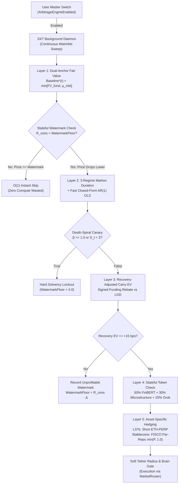

# PegGuard: Autonomous Peg Arbitrage & Quantitative Risk Sentinel

> **Transcribed from the original technical whitepaper:** [`docs/pdf/PegGuard.pdf`](../pdf/PegGuard.pdf)  
> **Project Name:** PegGuard  
> **Subtitle:** An Autonomous, Stateful-Watermark, Regime-Switching & Recovery-Risk-Adjusted Quantitative Arbitrage Framework Across Ethereum, Arbitrum, and FISCO BCOS  
> **Author:** Ahmed Fouad  

---

## Executive Summary

### Overview: Autonomous Multi-Chain Peg Arbitrage & Capital Preservation
Modern financial markets feature rapid growth in tokenized Real-World Assets (RWAs) and pegged instruments across **Ethereum Mainnet (L1)** and **Arbitrum One (L2)**, spanning fiat-backed and decentralized stablecoins (`USDC`, `USDT`, `DAI`, `FRAX`, `USDe`, `crvUSD`, `GHO`, `LUSD`), liquid staking and restaking derivatives (`stETH`, `wstETH`, `WBETH`, `rETH`, `cbETH`, `weETH`, `ezETH`), wrapped Bitcoin (`WBTC`, `cbBTC`, `tBTC`), and tokenized commodities/treasuries (`PAXG`, `XAUT`, `USDY`, `OUSG`).

Conventional quantitative strategies make a fatal conceptual error: **they treat statistical mean reversion as synonymous with riskless financial arbitrage**. Buying a discounted pegged asset is not pure arbitrage if the underlying peg mechanism itself is impaired, if carry and panic slippage erase the spread, or if the hedge leg introduces short-squeeze risk.

To resolve these flaws, PegGuard operates as a **User-Toggled Autonomous Arbitrage Daemon** equipped with **Stateful Unprofitable-Price Watermark Memory** and a **5-Layer Quantitative & Multi-Modal Risk Funnel**. When toggled `ON`, PegGuard continuously scans all target assets across Ethereum, Arbitrum, and centralized venues, routing approved trades through asset-specific perpetual hedges or an institutional **FISCO BCOS Par-Capped Repo Facility**.

---

## 1. Problem Statement: The Five Structural Failure Modes

1. **The Fair-Value vs. Market-Consensus Fallacy:** Relying purely on moving averages ignores sudden reserve impairment (e.g., bank lockups), while relying purely on theoretical par value ($1.00) ignores persistent market-priced risk discounts and accruing staking yields.
2. **Regime Blindness & Broken Mean-Reversion:** Single-state Ornstein-Uhlenbeck (O-U) models calibrate reversion speed ($\theta$) on calm periods. When a peg enters fundamental collapse (e.g., Terra/UST), historical reversion speed becomes meaningless, leading bots to buy a terminal death spiral.
3. **Carry-Cost Bleed, Panic Slippage & Recovery Risk:** Apparent arbitrage spreads evaporate once accounting for multi-week borrow drag, redemption queue delays, L2 order-book depth contraction during panic, and expected Loss Given Default (LGD).
4. **Flawed Delta-Neutral Hedging & Stablecoin Contagion:** Shorting BTC/ETH to hedge a fiat stablecoin (USDC) introduces massive directional risk, whereas shorting a rival stablecoin (USDT) on retail perps exposes the trader to flight-to-safety short squeezes ($> \$1.04$) and cross-stablecoin contagion.
5. **Stateless Re-Evaluation Spam on Shallow Dislocations:** Conventional bots repeatedly run expensive econometric and NLP checks every second on the exact same unprofitable de-peg price, exhausting compute and API limits instead of memorizing the unprofitable price floor and waiting for a deeper discount.

---

## 2. Autonomous Daemon & Stateful Watermark Memory

Rather than requiring manual CLI invocations for single asset pairs, PegGuard is engineered as a continuous, event-driven background daemon controlled by a live user state switch and an intelligent anti-spam price memory cache.

### 2.1 Live User Master Toggle (`ArbitrageEngineEnabled` $\in \{\text{True}, \text{False}\}$)
The user controls a single master operational switch that can be flipped ON or OFF at any time without restarting the infrastructure:
* **When Enabled (ON):** The daemon continuously sweeps the entire multi-chain watchlist across Ethereum L1, Arbitrum L2, and Binance, evaluating real-time consensus price ratios $R_{\text{cons}}(t)$ and standardized anomaly scores $Z(t)$.
* **When Disabled (OFF):** The scanner immediately halts new trade entries while continuing to monitor open hedged positions until target peg convergence or manual unwind.

### 2.2 Stateful Unprofitable-Price Watermark Memory ($\text{WatermarkFloor}_i$)
When a monitored token de-pegs ($|Z_i(t)| \ge 2.0$), PegGuard triggers Layers 2, 3, and 4 to verify whether the net trade is profitable after borrow APR, signed funding, taker fees, panic slippage, and default risk. If the trade is not profitable at the current de-pegged ratio $R_{\text{rejected}, i}$ (e.g., USDC de-pegs to $\$0.9940$, yielding $-6\text{ bps}$ Net EV after fees and carry), re-evaluating the exact same trade every second is wasteful.

PegGuard solves this via a **Stateful Unprofitable-Price Watermark Cache**:

$$\text{If Rejected at } R_{\text{rejected}, i}: \quad \text{WatermarkFloor}_i = \min\left[ R_{\text{rejected}, i} - \Delta_{\text{step}}, \, R_{\text{breakeven}, i}(\text{Carry}, \text{Fees}, \text{LGD}) \right]$$

$$\text{Re-Evaluation Trigger Rule}: \quad \text{Run Layers 2–4 iff } |Z_i(t)| \ge 2.0 \quad \text{AND} \quad R_{\text{cons}, i}(t) < \text{WatermarkFloor}_i$$

| Daemon State / Condition | Mathematical Trigger | PegGuard Autonomous Action |
|---|---|---|
| **Normal Peg Regime** | $\|Z_i(t)\| < 1.5$ | Clears any cached watermark ($\text{WatermarkFloor}_i = \text{None}$). Continues lightweight L1 scanning. |
| **Fresh Dislocation** | $\|Z_i(t)\| \ge 2.0$ and $\text{WatermarkFloor}_i \text{ is None}$ | Passes asset through Layers 2, 3 & 4 to evaluate duration, signed carry EV, and solvency. |
| **Unprofitable Dislocation Noted** | $EV_{\text{rec}} < \text{Hurdle}$ at price $R_{\text{eval}}$ | Records $\text{WatermarkFloor}_i = R_{\text{eval}} - \Delta$. Suppresses repeat Layer 2–4 calls at or above this price. |
| **Stagnant De-Peg (Skipped)** | $\|Z_i(t)\| \ge 2.0$ and $R_{\text{cons}, i}(t) \ge \text{WatermarkFloor}_i$ | **$O(1)$ Instant Skip**: Price has not dropped lower than the noted unprofitable level; zero wasted compute. |
| **Deeper Discount Re-Check** | $\|Z_i(t)\| \ge 2.0$ and $R_{\text{cons}, i}(t) < \text{WatermarkFloor}_i$ | **Wakes Up Pipeline**: Price dropped lower! Re-runs Layers 2–4 to check if the wider spread is now profitable. |
| **Hard Solvency Veto Lockout** | $S_t = 3$ or $P(\text{Insolvency}) \ge 0.60$ | Sets $\text{WatermarkFloor}_i = 0.0$ (**LOCKED**). Blocks all buying regardless of how low the price falls. |

---

## 3. Multi-Chain Asset Universe: Ethereum (L1), Arbitrum (L2) & FISCO BCOS

When enabled, PegGuard continuously monitors 25 pegged, staked, and tokenized assets across Ethereum Mainnet (L1) and Arbitrum One (L2), leveraging L1 for primary redemption/solvency telemetry, Arbitrum L2 for sub-second low-gas execution, and FISCO BCOS for institutional par-capped repo hedging and immutable risk auditing.

### Class B1: Fiat-Backed & Decentralized Stablecoins (Hedged via FISCO BCOS Par-Capped Repo)
| Pegged Asset | Real Anchor | Peg Mechanism & Backing | Venues (L1 & L2) | FISCO BCOS & PegGuard Role |
|---|---|---|---|---|
| **USDC** (Circle) | USD (T-Bills/Cash) | 1:1 Fiat-Backed (Circle primary mint/burn) | L1: Curve 3pool, UniV3, Aave V3 Arb: Native USDC, Curve 2pool, Camelot | Primary Par-Repo Collateral; cross-chain state lock with FISCO BCOS vault. |
| **USDT** (Tether) | USD (T-Bills/Repo) | 1:1 Fiat-Backed (0.10% redemption fee) | L1: Curve 3pool, UniV3, Aave V3 Arb: Curve 2pool, UniV3, Aave V3 | Par-Capped Short Liability Benchmark ($\min[P_{\text{USDT}}, 1.000]$ prevents $>\$1.00$ squeeze). |
| **DAI / USDS** (Sky) | USD (Crypto/RWA/PSM) | 1:1 Soft-Pegged via USDC PSM & T-Bills | L1: Curve 3pool, Spark, Aave V3 Arb: Curve, UniV3, Balancer, Aave V3 | Contagion Matrix ($\beta_{ij}$) tracked asset (high reserve correlation to USDC). |
| **FRAX** (Frax) | USD (Hybrid RWA/AMO) | 1:1 Hybrid Collateralized (Curve AMO + sFRAX) | L1: Curve FRAX/USDC, Fraxlend Arb: Curve, Camelot, Ramses, Fraxlend | Contagion Matrix ($\beta_{ij}$) tracked asset (coupled via Curve FRAXBP). |
| **USDe** (Ethena) | USD (Spot + Short Perp) | 1:1 Delta-Neutral Synthetic Dollar | L1: Curve USDe/USDC, Morpho, Pendle Arb: Curve, Camelot, Pendle, Morpho | High-carry basis target; Layer 3 compares Ethena funding vs. FISCO repo cost. |
| **crvUSD & GHO** | USD (Overcollateralized) | LLAMMA soft-liquidation (Curve) / Aave GSM | L1 & Arb: Curve, Balancer, UniV3, Aave V3 | Ideal Layer 1 Dual-Anchor cases (structural discounts vs. par solvency). |
| **LUSD, PYUSD, EURC** | USD / EUR | 100% ETH floor (LUSD) / Regulated Fiat | L1 & Arb: Curve PayPool, LUSD/3Crv, UniV3, Aave V3 | LUSD acts as inverse flight-to-safety indicator; PYUSD/EURC for multi-currency repo. |

### Class A1: Liquid Staking & Restaking Derivatives — LSTs & LRTs (Hedged via Short ETH-PERP)
| Pegged Asset | Real Anchor | Peg Type & Fair-Value Growth | Venues (L1 & L2) | Layer 1 $FV_{\text{fund}}$ & FISCO BCOS Role |
|---|---|---|---|---|
| **stETH & wstETH** (Lido) | ETH (Beacon Staked) | Rebasing 1:1 (stETH) / Yield-Accruing ($FV_{\text{fund}} \approx 1.18+\text{ ETH}$) | L1: Curve stETH/ETH, UniV3, Aave V3 Arb: Deepest L2 LST (UniV3, Balancer, Camelot) | Primary Arbitrum LST target; tracks Lido withdrawal queue delay ($\tau_{\text{redeem}}$). |
| **WBETH** (Binance) | ETH (Binance Staked) | Yield-Accruing Ratio ($FV_{\text{fund}} \approx 1.085+\text{ ETH}$) | L1 & CEX: Binance Spot, Curve WBETH/ETH, UniV3 | Dual-path triangulation benchmark; Oct 2025 flash-crash validation asset. |
| **rETH & cbETH** | ETH (RocketPool/Coinbase) | Yield-Accruing Ratios ($1.12+ / 1.07+\text{ ETH}$) | L1 & Arb: UniV3, Balancer, Curve, Aave V3 | Layer 4 FinBERT monitors custodial/regulatory news vs. on-chain node burns. |
| **weETH & ezETH** (LRTs) | ETH (EigenLayer Restaked) | Yield-Accruing Restaking Ratios ($1.05+\text{ ETH}$) | L1 & Arb: Curve, UniV3, Camelot, Pendle, Aave V3 | Models 7-day EigenLayer escrow lag ($\tau_{\text{redeem}} \ge 7\text{d}$) during L2 panic sells. |

### Class A2 & B2: Wrapped Bitcoin & Tokenized RWAs
| Pegged Asset | Real Anchor | Peg Mechanism & Custodian | Venues (L1 & L2) | Hedging & FISCO BCOS Role |
|---|---|---|---|---|
| **WBTC, cbBTC, tBTC** | BTC (1:1 Native Bitcoin) | Custodial (BitGo/Coinbase) & Threshold Bridge | L1 & Arb: UniV3 (cbBTC/WBTC), Curve, Camelot, Aave V3 | Hedged via Short BTC-PERP or cross-arbitraged (`cbBTC/WBTC` basis). |
| **PAXG & XAUT** | Gold (1 Troy Oz XAU) | 1:1 Physical London Good Delivery / Swiss Gold | L1 & Arb: UniV3 (PAXG/USDC, PAXG/XAUT), Curve | Hedged via XAU-PERP or delta-neutral PAXG/XAUT pair ($\tau_{\text{redeem}} = \text{T}+2$). |
| **USDY & OUSG** (Ondo) | US T-Bills (Short-Term) | Yield-Accruing RWA Token (~4.5–5.0% APY) | L1 & Arb: Curve, Flux Finance, Arbitrum RWA Pools | Pledged as institutional RWA collateral inside FISCO BCOS Par-Capped Repo vaults. |

---

## 4. Layer 1: Dual-Anchor Fair-Value & Spot Triangulation

A robust valuation model must account for two realities simultaneously:
1. **Economic Fundamental Fair Value ($FV_{\text{fund}}$)**: Grounded in reserve quality, redemption mechanics, and staking yield.
2. **Empirical Market Consensus ($\mu_{\text{mkt}}$)**: Capturing unobserved market-priced risks and persistent structural discounts.

### 4.1 Economic Fundamental Fair-Value Benchmark ($FV_{\text{fund}}$)
Rather than assuming par value is always $1.000$, the fundamental value $FV_{\text{fund}}(t)$ discounts par value by verifiable reserve solvency, redemption rights, liquidity depth, and asset-specific cash flows (such as staking yield $y_{\text{asset}}$ minus redemption fees $r_{\text{fee}}$ over primary settlement delay $\tau_{\text{redeem}}$):

$$FV_{\text{fund}}(t) = P_{\text{par}} \times \min\left(1, \frac{\text{LiquidReserves}_t}{\text{CirculatingSupply}_t}\right) \times \exp\left[ (y_{\text{asset}} - r_{\text{fee}} - c_{\text{illiquidity}}) \times \tau_{\text{redeem}} \right]$$

### 4.2 Multi-Horizon Market Consensus ($\mu_{\text{mkt}}$) & Dual-Path Spot Triangulation
During liquidity crunches, direct spot books (`WBETH/ETH`) frequently dislocate from synthetic cross-rates (`(WBETH/USDT)/(ETH/USDT)`). Layer 1 synthesizes a dual-path consensus ratio $R_{\text{cons}}(t)$ and tracks empirical equilibrium across three rolling windows (1-Week $\mu_{1\text{w}}$, 1-Month $\mu_{1\text{m}}$, and 1-Year $\mu_{1\text{y}}$):

$$R_{\text{cons}}(t) = w_{\text{dir}} \times R_{\text{direct}}(t) + (1 - w_{\text{dir}}) \times \left[ \frac{P_{\text{pegged/USDT}}(t)}{P_{\text{anchor/USDT}}(t)} \right]$$

$$\mu_{\text{mkt}}(t) = w_{1\text{w}} \times \overline{R}_{1\text{w}}(t) + w_{1\text{m}} \times \overline{R}_{1\text{m}}(t) + w_{1\text{y}} \times \overline{R}_{1\text{y}}(t)$$

### 4.3 The Conservative Dual-Anchor Baseline ($\text{Baseline}^*(t)$)
Layer 1 synthesizes both anchors using a **Conservative Minimum Operator** to define the actionable convergence target $\text{Baseline}^*(t)$ and standardized dislocation $Z(t)$ against 30-day rolling volatility $\sigma_{30\text{D}}(t)$:

$$\text{Baseline}^*(t) = \min\left[ FV_{\text{fund}}(t), \, \mu_{\text{mkt}}(t) \right]$$

$$\text{Abnormal Spread } \delta(t) = R_{\text{cons}}(t) - \text{Baseline}^*(t), \qquad Z\text{-Score}(t) = \frac{\delta(t)}{\sigma_{30\text{D}}(t)}$$

---

## 5. Layer 2 & 3: 3-Regime Duration & Signed Recovery-Risk EV Gate

### 5.1 Layer 2: 3-Regime Markov-Switching Duration & Fast OLS Fallback
Calibrating a single Ornstein-Uhlenbeck (O-U) reversion speed $\theta$ on historical data fails when a peg fractures, while pure Maximum-Likelihood Markov-Switching (Hamilton EM filter) can fail to converge on noisy windows. Layer 2 uses a **Two-Stage Hybrid Estimator**: a deterministic $<15\text{ms}$ Closed-Form AR(1) OLS Engine ($\Delta \delta_t = \alpha + \kappa \delta_{t-1} + \varepsilon_t$) with Delta-method standard errors that initializes and provides a real-time fallback for the 3-Regime Markov-Switching SDE across latent states $S_t \in \{1, 2, 3\}$:

$$d\delta(t) = \theta(S_t) \times \left[ \mu(S_t) - \delta(t) \right] dt + \sigma(S_t) \, dW(t), \qquad t_{1/2}(S_t) = \frac{\ln(2)}{\theta(S_t)}$$

$$\text{Fast OLS Initializer & Fallback}: \quad \theta_{\text{OLS}} = -\frac{\ln(1 + \kappa)}{\Delta t} \qquad (\text{Death Spiral Canary: Veto } S_t = 3 \text{ if } \beta = 1 + \kappa \ge 1.0)$$

* **Regime 1 ($S_t = 1$, Normal Microstructure):** High reversion speed ($\theta_1 \gg 0$), low $\sigma_1$, rapid half-life (minutes to hours).
* **Regime 2 ($S_t = 2$, Temporary Liquidity Distress):** Reserves remain solvent ($FV_{\text{fund}} \approx 1$), but panic selling depletes order books (e.g., USDC during SVB or stETH during 3AC). Reversion $\theta_2$ slows to days and $\sigma_2$ spikes.
* **Regime 3 ($S_t = 3$, Fundamental Peg Collapse):** Reserve insolvency or non-stationary divergence ($\beta \ge 1.0$, $\theta_3 \le 0$, $t_{1/2} \to \infty$). Historical reversion parameters are invalidated and all buying is locked out.

### 5.2 Layer 3: Recovery-Risk EV & Signed Perpetual Funding Gate
Because PegGuard executes Long Discounted Spot + Short Reference Perpetual, perpetual funding is directionally signed: when the 8-hour funding rate $F_{8\text{h}} > 0$ (contango), longs pay shorts—meaning our short hedge earns a positive funding rebate! Carry only becomes a cost drag when $F_{8\text{h}} < 0$ (backwardation during panic shorting) or via cross-margin borrow interest ($\text{BorrowCost}$). Layer 3 weighs this signed net gain against Probability of Recovery ($P_{\text{rec}}$), Loss Given Default ($\text{LGD}$), and non-linear panic slippage:

$$\text{SignedFundingCF} = +F_{8\text{h}} \times \left[ \frac{T_{\text{exp}}(S_t)}{8\text{h}} \right] \quad (\text{Yield Rebate if } F_{8\text{h}} > 0 \text{ on Short Perp; Cost Drag if } F_{8\text{h}} < 0)$$

$$\text{NetGain}_{\text{rec}} = |\delta(t)| + \text{SignedFundingCF} - \text{BorrowCost}(T_{\text{exp}}) - 2 \times \text{TakerFee} - \text{Slippage}(Q, \text{Depth}_t, \tau_{\text{redeem}})$$

$$\text{Recovery-Adjusted EV} = P_{\text{rec}} \times \text{NetGain}_{\text{rec}} - (1 - P_{\text{rec}}) \times \text{LGD}$$

**Execution Hurdle:** A trade is authorized only if $S_t \ne 3$ ($\beta < 1.0$) and $\text{Recovery-Adjusted EV} \ge \text{HurdleRate}$ ($+15\text{ bps}$).

---

## 6. Layer 4: Stateful Asset-Specific Token Check

Broad crypto sentiment and perpetual futures Open Interest (OI) are largely irrelevant for pegged assets. Layer 4 executes a stateful Asset-Specific Token Check ($T_t \in [0, 1]$) over the delta window $\Delta t = t_{\text{now}} - t_{\text{last\_check}}$ (defaulting to a 7-day lookback):

### 6.1 Stateful FinBERT News & Filing Sentinel (50% Weight + Hard Veto Gate)
Evaluates token-specific news, reserve attestations, custodian disclosures, and regulatory filings using `ProsusAI/finbert` with Named Entity Recognition (NER) and exponential time-decay weighting ($w_i = \exp(-\lambda \Delta t_i)$):
* **Solvency vs. Liquidity Separation:** Distinguishes temporary banking delays from permanent reserve impairment.
* **Binary Hard Veto ($I_{\text{SafeVeto}} = 0$):** If FinBERT detects structural insolvency, custodian bankruptcy, or an exploit ($P(\text{Insolvency}) \ge 0.60$), it zeroes out the entire Token Check score immediately and locks $\text{WatermarkFloor} = 0.0$.

### 6.2 On-Chain & Spot Peg Microstructure Matrix (30% Weight)
Tracks the four exact mechanisms where stablecoin and pegged-asset stress materializes:
1. **Curve / DEX Pool Balance Tilt:** Waits while pool skew is accelerating ($>75\%$ dumped asset) and signals entry when pool imbalance peaks and reverses.
2. **DeFi Lending Utilization & Borrow APR Squeeze (Aave V3 / Morpho):** When utilization crosses the kink ($>90\%$) and borrow APR spikes ($>50\%$ APR) while FinBERT confirms solvency, on-chain shorts are forced to buy back to repay debt.
3. **Primary Mint / Burn Redemption Velocity:** Verifies that on-chain token burns are active during a discount, proving institutional arbitrageurs are successfully redeeming at par.
4. **Spot Order-Book Imbalance (OFI) & Bid-Wall Refill:** Confirms bid-to-ask depth recovery within $0.5\%$ of mid-price.

### 6.3 Grok API Dual-Persona Token Check (20% Weight)
Queries live X/Twitter discourse: acts contrarian on emotional retail panic, but flips to a strict directional veto if security monitors (PeckShield, Lookonchain) flag an active exploit or issuer freeze.

$$T_t = I_{\text{SafeVeto}} \times \left[ 0.50 \times F_{\text{FinBERT}} + 0.30 \times M_{\text{OnChain+Spot}} + 0.20 \times G_{\text{Grok}} \right], \quad \text{where } I_{\text{SafeVeto}} = 0 \text{ if } P(\text{Insolvency}) \ge 0.60$$

---

## 7. Layer 5: Asset-Specific Hedging & FISCO BCOS Par-Repo

A single delta-neutral mechanism cannot be applied blindly. Layer 5 enforces Asset-Specific Hedging:

### 7.1 Class A: Crypto-Pegged Derivatives (stETH, wstETH, WBETH, WBTC)
Executes simultaneous **Long Spot on Arbitrum/Ethereum + Short Reference Perpetual (ETH-PERP or BTC-PERP)**, neutralizing underlying crypto delta while locking in the structural staking basis.

### 7.2 Class B: Fiat-Pegged Stablecoins via FISCO BCOS Par-Capped Repo
To hedge a discounted long position (e.g., buying USDC at $\$0.90$) without directional crypto exposure or retail order-book squeeze risk, PegGuard routes the short leg through an **On-Chain Institutional Repo & Settlement Facility** built on **FISCO BCOS / EVM smart contracts**:

* **Par-Capped Liability (Zero Short-Squeeze Risk):** The borrowed USDT debt obligation is programmatically anchored and capped at its legal primary redemption par value ($\$1.000$). Even if retail exchange order books temporarily spike USDT to $\$1.04$ during a flight to safety, the smart-contract liability cannot exceed $1.000$, eliminating artificial margin liquidations.
* **Asymmetric Downside Convexity:** If the shorted stablecoin (USDT) suffers its own de-peg below $\$1.00$, the repayment liability shrinks proportionally, turning counterparty de-peg risk into an asymmetric hedge gain inside an isolated non-custodial vault.

$$\text{Effective Short Liability}(t) = \min\left[ P_{\text{USDT}}(t), \, 1.000 \right] \times Q_{\text{borrowed}}$$

### 7.3 Cross-Stablecoin Contagion Matrix ($\beta_{ij}$) & Convex Position Sizing
When USDC de-pegged in March 2023, DAI and FRAX simultaneously de-pegged due to shared reserve collateral and Curve 3pool liquidity coupling. PegGuard maintains a dynamic Contagion Exposure Matrix ($\beta_{ij}$) measuring reserve overlap and pool co-dependency:

$$\text{OrderSize}_i = \text{BaseSize} \times \left[ 1 + \alpha \times (|Z_i| - \text{Threshold})^2 \right] \times T_{i, t} \times \max\left[ 0, \, 1 - \sum_{j \ne i} \beta_{ij} \times \text{DistressProb}_j \right]$$

**Portfolio Contagion Brake:** If Stablecoin $j$ enters Regime 2 or 3 distress, the term $\sum \beta_{ij} \text{DistressProb}_j$ automatically scales down capital allocation across all correlated stablecoins $i$, protecting the portfolio from systemic domino cascades.

---

## 8. Comparative Analysis: PegGuard vs. Conventional Models

| Dimension | Standard Retail / Grid Bot | Conventional Stat-Arb (Moving Average + O-U) | Upgraded PegGuard Framework |
|---|---|---|---|
| **Scanning & State Memory** | Stateless polling; spams orders on static price grids. | Re-runs full model on every tick regardless of prior rejection. | **Autonomous Master Toggle + Stateful Watermark Floor** (re-evaluates only when price drops lower). |
| **Fair-Value Benchmark** | Rigid static par ($1.000$). | Pure historical moving averages (blind to reserve collapse). | **Conservative Dual-Anchor** $\min(FV_{\text{fund}}, \mu_{\text{mkt}})$ + Dual-Path Spot Triangulation ($R_{\text{cons}}$). |
| **Regime & Duration Modeling** | None. | Single-state O-U process assuming constant reversion speed $\theta$. | **3-Regime Markov-Switching SDE** with deterministic $<15\text{ms}$ Closed-Form AR(1) OLS Fallback. |
| **EV & Microstructure Gate** | Ignores funding, depth, and default risk. | Adjusts only for static transaction fees; treats all funding as cost. | **Recovery-Risk EV** integrating $P_{\text{rec}}$, $\text{LGD}$, Signed Perp Funding (rebate vs. drag), and depth decay. |
| **Signal & Adverse Selection** | Price-only triggers; buys falling knives to $\$0.00$. | Lagging price stop-losses after capital impairment. | **Asset-Specific Token Check**: FinBERT Sentinel (50% + Veto) + Curve/Aave/Burn Flow (30%) + Grok (20%). |
| **Hedging & Contagion** | Unhedged directional exposure. | Naive perp shorting (vulnerable to $>\$1.00$ squeezes & contagion). | **Asset-Specific Hedge**: FISCO BCOS Par-Capped USDT Repo + Cross-Coin Contagion Matrix ($\beta_{ij}$). |

---

## 9. Historical Validation & Stress Testing

| Historical Crisis | Asset Scope | Market Dynamics | PegGuard Validation Outcome |
|---|---|---|---|
| **SVB Collapse** (March 2023) | USDC, DAI, FRAX / USDT | USDC dropped to $\$0.88$; Curve 3pool tilted $>80\%$ USDC/DAI; retail USDT spiked to $\$1.04$. | **Regime 2 + Contagion Proof:** Watermark skips shallow $\$0.994$ dip; triggers at deeper discount. Contagion matrix ($\beta_{ij}$) halts double-dipping in DAI/FRAX; FISCO BCOS par-capped hedge prevents $\$1.04$ USDT squeeze. |
| **Terra / UST Collapse** (May 2022) | UST / USD | Mint-burn death spiral; $FV_{\text{fund}}$ collapsed to $\$0.00$ while 30-day moving average remained near $\$1.00$. | **Regime 3 Survival Proof:** Models A & B suffer $-100\%$ loss relying on historical $\theta$. PegGuard switches to Regime 3 ($I_{\text{SafeVeto}} = 0$, $\text{WatermarkFloor} = 0.0$), **preserving 100% of capital**. |
| **stETH Liquidity Crisis** (June 2022) | stETH, wstETH / ETH | 7% discount from 3AC forced liquidations; Beacon ETH reserves remained 100% solvent. | **FinBERT + On-Chain Flow Proof:** FinBERT confirms zero protocol insolvency; Curve pool tilt stabilization signals exhaustion; ETH-PERP hedge harvests spread safely. |
| **Order-Book Panic Stress Test** | All 25 Target Pairs ($10\text{k}–\$10\text{M}$) | Simulates order-book depth contraction (80% drop) and $\text{T}+3$ redemption bottlenecks. | **Microstructure Decay Proof:** Quantifies the exact capital capacity threshold where panic slippage and redemption lag erase theoretical arbitrage alpha. |

---

## 10. Academic References

1. **Hamilton, J. D. (1989).** *A new approach to the economic analysis of nonstationary time series and the business cycle.* Econometrica, 57(2), 357-384. (Foundational Markov regime-switching model).
2. **Avellaneda, M., & Stoikov, S. (2008).** *High-frequency trading in a limit order book.* Quantitative Finance, 8(3), 217-224.
3. **Araci, D. (2019).** *FinBERT: Financial Sentiment Analysis with Pre-trained Language Models.* arXiv preprint arXiv:1908.10063.
4. **Lyons, R. K., & Viswanath-Natraj, G. (2023).** *What keeps stablecoins stable?* Journal of International Money and Finance, 131, 102777. (Redemption rights, reserve quality, and fundamental stablecoin arbitrage).
5. **Gatev, E., Goetzmann, W. N., & Rouwenhorst, K. G. (2006).** *Pairs trading: Performance of a relative-value arbitrage rule.* The Review of Financial Studies, 19(3), 797-827.
6. **Cartea, Á., Jaimungal, S., & Penalva, J. (2015).** *Algorithmic and High-Frequency Trading.* Cambridge University Press.
7. **European Central Bank (2023).** *Stablecoins, de-pegging events, and systemic contagion in crypto-asset markets.* ECB Macroprudential Bulletin.
