# Tec-C: PegGuard Arbitrage Framework (Domain 09)

> **Master Whitepaper Reference**: Transcribed from [`PegGuard.pdf`](../pdf/PegGuard.pdf) (12 Pages Master Quantitative Specification).  
> **Full Technical Specification**: See [`PEGGUARD_SPECIFICATION.md`](./PEGGUARD_SPECIFICATION.md).  
> **Production Code**: [`agent/tecc_brain/pegguard/`](../../agent/tecc_brain/pegguard/) & [`agent/tecc_brain/market/live_feed.py`](../../agent/tecc_brain/market/live_feed.py).  
> **Frontend Telemetry**: [`web/app.html`](../../web/app.html) & [`web/assets/js/app.js`](../../web/assets/js/app.js).

---

## 1. Executive Summary & Problem Formulation

Traditional statistical arbitrage models treat pegged assets (fiat stablecoins, liquid staking derivatives, and tokenized commodities) as simple mean-reverting time series governed by standard Ornstein-Uhlenbeck (OU) processes:

$$dX_t = \theta (\mu - X_t) dt + \sigma dW_t$$

During systemic credit, liquidity, or de-pegging shocks (e.g., Terra/UST death spiral, Silicon Valley Bank run on USDC, 3AC cascade), standard mean-reversion models suffer from **five catastrophic structural failure modes**:

```
┌────────────────────────────────────────────────────────────────────────┐
│             5 Structural Failure Modes of Naive Stat-Arb               │
├────────────────────────────────────────────────────────────────────────┤
│ 1. Structural Break Blindness   │ Buys fatal death-spirals as "cheap"  │
│ 2. Funding Rate Bleed           │ Carry costs exceed mean reversion    │
│ 3. Bad Debt Contagion           │ Secondary collaterals liquidate      │
│ 4. Tail Execution Slippage      │ Liquidity evaporates when needed     │
│ 5. Asymmetric Payoff Delusion   │ Cap = $1.00, Downside = -$1.00       │
└────────────────────────────────────────────────────────────────────────┘
```

**PegGuard** is Tec-C's 5-layer quantitative arbitrage engine. It rejects the naive mean-reversion assumption, treating de-pegged assets as credit default claims with asymmetric payoffs, non-stationary jump-diffusion drift, and cross-venue contagion.

---

## 2. The 5-Layer Econometric Funnel

PegGuard filters 25 pegged assets across Ethereum (L1), Arbitrum (L2), and FISCO BCOS consortium chains through a rigorous 5-layer mathematical pipeline. An asset must pass **all 5 layers** before any capital can be allocated.

```mermaid
flowchart TD
    Universe["25-Asset Universe (USD, LST/LRT, RWA, Gold)"] --> L1
    
    subgraph L1 ["Layer 1: Dual-Anchor Calibration"]
        L1_Val["Calculate FV_fund (Reserves, Haircuts)"]
        L1_Cons["Multi-Horizon Consensus (1m, 5m, 1h TWAP)"]
        L1_Triang["Spot Triangulation (Direct vs Synthetics)"]
    end
    
    L1 -->|Verified Inefficiency| L2
    
    subgraph L2 ["Layer 2: Markov Regime Duration SDE"]
        L2_Regime["3-Regime Switching: Transient | Credit Stress | Death Spiral"]
        L2_Jump["SDE: Jump-Diffusion with Poisson Crash Intensity"]
        L2_Canary["Death-Spiral Canary: beta >= 1.0 (Hard Veto)"]
    end
    
    L2 -->|P_rec >= 70% & tau <= 48h| L3
    
    subgraph L3 ["Layer 3: Recovery-Adjusted Carry Gate"]
        L3_EV["Expected Value: EV = P_rec * Gain + (1-P_rec)*(-LGD) - Carry"]
        L3_Gate["Threshold: EV >= +15 bps (Directional Funding Rebates)"]
    end
    
    L3 -->|EV Approved| L4
    
    subgraph L4 ["Layer 4: Tri-Factor Token Health Filter"]
        L4_FinBERT["50% FinBERT Financial Sentiment"]
        L4_Flow["30% Microstructure CVD & Order-Book Skew"]
        L4_Grok["20% Real-Time Grok Event Classifier"]
        L4_Veto["Hard Veto on Insolvency / Regulatory Enjoinment"]
    end
    
    L4 -->|Health Index >= 60/100| L5
    
    subgraph L5 ["Layer 5: Contagion Brake & Hedging"]
        L5_Hedge["Asset-Specific Short Perpetuals (Aave / Hyperliquid)"]
        L5_Repo["FISCO BCOS Par-Capped Repo: Liability = min(P, 1.000)"]
        L5_Brake["Cross-Stablecoin Contagion Matrix (beta_ij Position Scaling)"]
    end
    
    L5 --> Order["Tec-C Tether Radius & AI Brain Verification"]
    Order --> Execution["Atomic Cross-Chain Execution (ERC-7579 / FISCO BCOS)"]
```



### Funnel Layer Breakdown

| Layer | Component | Mathematical / Algorithmic Mechanism | Failure Outcome |
|---|---|---|---|
| **Layer 1** | **Dual-Anchor Calibration** | Calculates fundamental fair value $FV_{\text{fund}}$ from collateral disclosures and balances against multi-horizon consensus $\mu_{\text{mkt}}$ with direct cross-pair triangulation. | Reject transient oracle noise / fake liquidity. |
| **Layer 2** | **Markov Regime Duration SDE** | 3-Regime Markov switching ($S_t \in \{1, 2, 3\}$). Evaluates recovery half-life $t_{1/2}$ and monitors the Death-Spiral Canary ($\beta = \frac{d(\Delta P)}{d(\Delta \text{Circulation})} \ge 1.0$). | Immediate hard veto on death spiral. |
| **Layer 3** | **Recovery Carry Gate** | Calculates net expected value $\mathbb{E}[\text{Carry}] = P_{\text{rec}} \cdot \Delta P + (1 - P_{\text{rec}}) \cdot (-LGD) - \int (r_{\text{borrow}} - f_{\text{perp}}) dt$. Requires $\ge +15\text{ bps}$. | Reject negative-carry or high-LGD opportunities. |
| **Layer 4** | **Tri-Factor Asset Health** | Composite health score $H_t = 0.50 \cdot S_{\text{FinBERT}} + 0.30 \cdot M_{\text{flow}} + 0.20 \cdot G_{\text{Grok}}$. Hard veto on custodial freezing or bank insolvency. | Filter unbacked or regulatory-threatened assets. |
| **Layer 5** | **Contagion Brake & Hedging** | Short perpetual delta-hedges or FISCO BCOS Par-Capped Repo ($\text{Liability} = \min[P, 1.000]$). Positions scaled by the cross-asset contagion matrix $\beta_{ij}$. | Prevent portfolio drawdown from cascading de-pegs. |

---

## 3. 24/7 Autonomous Background Daemon & Watermark Memory

PegGuard is designed as an autonomous, user-toggleable background daemon that scans the multi-chain asset universe 24/7 without requiring manual trader intervention.

```
┌────────────────────────────────────────────────────────────────────────┐
│                  PegGuard Autonomous Daemon Lifecycle                  │
├────────────────────────────────────────────────────────────────────────┤
│                                                                        │
│   Frontend Toggle [ON/OFF] ───► /api/arbitrage/toggle                  │
│                                           │                            │
│                                           ▼                            │
│   ┌────────────────────────────────────────────────────────────────┐   │
│   │ Background Thread: tecc_brain/pegguard/scanner.py               │   │
│   │                                                                │   │
│   │  1. Heartbeat Tick (every 30–60s) via market/live_feed.py      │   │
│   │  2. Stateful Watermark Memory Lookup: O(1) Amortized Skip     │   │
│   │  3. Evaluate Opportunities Through 5-Layer Funnel              │   │
│   │  4. Route Approved Opportunities to AI Brain & Tether Radius   │   │
│   │  5. Persist State (resumes automatically upon Brain restart)   │   │
│   │  6. Telemetry Broadcast: "last scan: 12s ago · 25 assets · 0"  │   │
│   └────────────────────────────────────────────────────────────────┘   │
└────────────────────────────────────────────────────────────────────────┘
```

### Stateful Watermark Memory ($O(1)$ Optimization)
To avoid redundant, expensive computations during prolonged de-pegs, PegGuard maintains an in-memory watermark cache of rejected price points:

$$\text{Watermark Cache}: \mathcal{M}(a) = \left( P_{\text{reject}}(a), \; t_{\text{reject}}(a), \; \text{Reason}(a) \right)$$

If an incoming price $P_t(a)$ satisfies:

$$\left| P_t(a) - P_{\text{reject}}(a) \right| < \epsilon_{\text{threshold}} \quad \text{and} \quad (t - t_{\text{reject}}) < \Delta t_{\text{cooldown}}$$

the scanner executes an **$O(1)$ immediate bypass**, bypassing Layers 2–5 entirely until prices move outside the deadband or collateral fundamentals change.

---

## 4. Multi-Chain Asset Universe (25 Assets Across 4 Categories)

PegGuard monitors 25 pegged assets across Ethereum (L1), Arbitrum (L2), and FISCO BCOS:

```
PegGuard 25-Asset Universe
├── 1. Fiat-Backed USD (7 Assets)
│   ├── USDT (Tether)
│   ├── USDC (Circle)
│   ├── FDUSD (First Digital)
│   ├── PYUSD (PayPal)
│   ├── USDD (Decentralized USD)
│   ├── GUSD (Gemini Dollar)
│   └── TUSD (TrueUSD)
├── 2. Decentralized & Crypto-Backed USD (6 Assets)
│   ├── DAI / USDS (MakerDAO / Sky)
│   ├── FRAX (Frax Finance)
│   ├── LUSD (Liquity v1)
│   ├── crvUSD (Curve)
│   └── GHO (Aave)
├── 3. Synthetic & Delta-Neutral USD (3 Assets)
│   ├── USDe (Ethena)
│   ├── sUSD (Synthetix)
│   └── USDF (FISCO BCOS Consortium Stablecoin)
└── 4. Liquid Staked Derivatives & RWAs (9 Assets)
    ├── wstETH (Lido)
    ├── rETH (Rocket Pool)
    ├── cbETH (Coinbase)
    ├── ezETH (Renzo LRT)
    ├── weETH (Ether.fi LRT)
    ├── osETH (StakeWise)
    ├── USDY (Ondo US Dollar Yield)
    ├── PAXG (Paxos Gold)
    └── XAUt (Tether Gold)
```

---

## 5. Strict Governance by Tec-C Invariants

In accordance with Tec-C's **Fail-Closed Strictness Hierarchy** (`docs/05_fail_closed_strictness_hierarchy/`):

1. **Never Autonomous Beyond Tether Radius**: PegGuard identifies and sizes arbitrage trades, but cannot execute orders that exceed the user's on-chain daily spending cap (`TetherRadius`).
2. **Mandatory Brain & Session Key Authorization**: All execution requests pass through `/api/mandate/execute` where the LangGraph AI Brain validates the order against the user's active session key.
3. **Biometric Breakout for Elevated Sizes**: If an arbitrage opportunity requires capital exceeding the autonomous threshold, the system enforces a Face ID WebAuthn breakout window.
4. **On-Chain Audit Commitment**: Every PegGuard trade anchors a SHA-256 state commitment (`audit_hash`) to the FISCO BCOS consortium ledger for regulatory compliance.

---

## 6. Directory Files

| File | Type | Description |
|---|---|---|
| [`README.md`](./README.md) | Domain Overview | Executive summary, 5-layer funnel architecture, and operational daemon guide. |
| [`PEGGUARD_SPECIFICATION.md`](./PEGGUARD_SPECIFICATION.md) | Master Specification | 12-page quantitative master whitepaper transcription covering all proofs, formulas, and crisis validations. |
| [`../../docs/pdf/PegGuard.pdf`](../pdf/PegGuard.pdf) | Master Whitepaper (PDF) | Original 12-page quantitative PDF whitepaper. |
